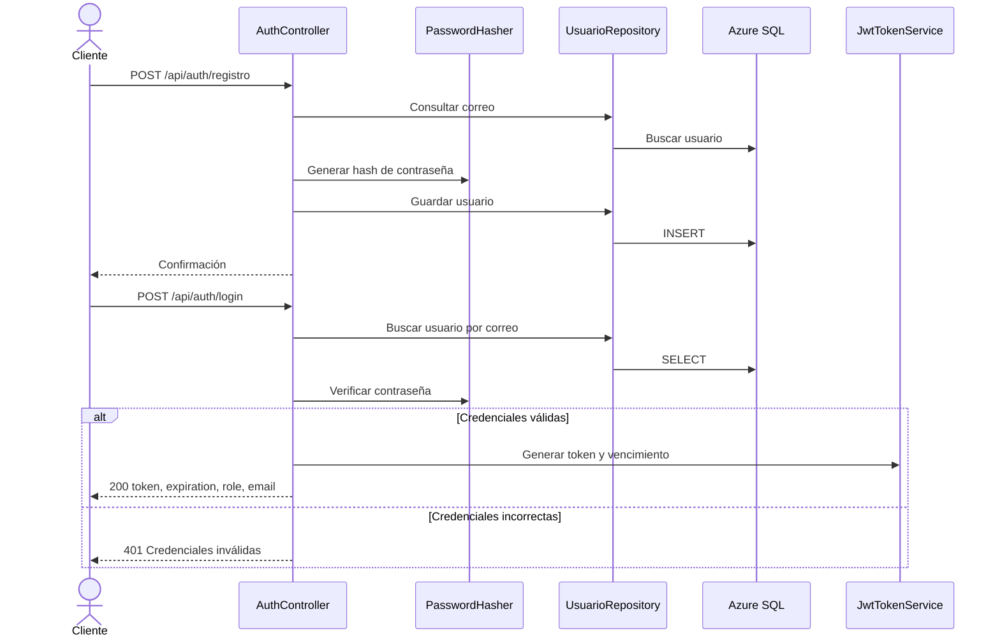

# Arquitectura de autenticación y plan de desarrollo

Responsable: Edgardo. Tarea 2.4: seguridad con JWT, roles y sesión Android.

## Estado actual del desarrollo

Se completó una primera implementación local de registro y login. Las secciones de revisión inicial y contrato objetivo conservan el diagnóstico previo; esta sección y la bitácora final indican qué se implementó realmente.

- DTO de registro sin Role; el controlador fija Usuario aunque el JSON incluya Admin.
- Validaciones declarativas: correo obligatorio, formato y máximo 254; contraseña de registro entre 8 y 128; login exige contraseña no vacía de máximo 128. Las contraseñas no se recortan.
- Correo normalizado con Trim y ToUpperInvariant en registro y login.
- Índice único en Email y migración nueva con comprobaciones previas de duplicados y longitud. La migración normaliza correos existentes; su reversión no restaura el formato anterior del correo.
- Excepción de aplicación para duplicados; Infrastructure traduce errores SQL Server 2601/2627 del guardado de usuario. No traduce otros fallos SQL a duplicados.
- Se mantienen las respuestas 200/400 de registro y 200/401 de login, PasswordHasher y el contrato token/expiration/role/email.

No se modificaron permisos de registros, implementación JWT de los compañeros ni Android. La validación adicional de configuración JWT al arrancar queda como coordinación con el responsable de seguridad.

## Alcance y estado de la revisión inicial

Este documento describe el código existente y el plan para completar registro e inicio de sesión. La revisión es estática: no demuestra que los endpoints funcionen contra una base de datos real. Los cambios de comportamiento descritos como pendientes todavía no se han implementado.

Trabajaremos localmente mientras se resuelven los permisos del repositorio. No hace falta ser administrador para colaborar: se requiere permiso de escritura para subir una rama al repositorio del equipo. Los commits locales se conservan aunque falle el push.

## Responsabilidad de Edgardo

Completar y verificar `POST /api/auth/registro` y `POST /api/auth/login`, incluyendo validaciones, hash de contraseña, persistencia del usuario y respuesta con JWT, vencimiento y rol. Documentar el contrato para Android y aportar las pruebas de autenticación.

La emisión y validación JWT se coordina con quien gestione la seguridad de la API. Los permisos de registros, las seis pruebas de seguridad, Android, OAuth 2.0 y el video son entregables del equipo; no se asignan automáticamente a Edgardo. Si su asignación también incluye las pantallas Android, hará falta el repositorio de esa aplicación.

## Arquitectura implementada actualmente

| Capa | Archivos principales | Responsabilidad actual |
| --- | --- | --- |
| Domain | `src/Bitacora.Domain/Entities/Usuario.cs` | Usuario con Id, Email, PasswordHash, Role y relación con registros. |
| Application | `DTOs/AuthDtos.cs`, `Interfaces/IUsuarioRepository.cs`, `Interfaces/ITokenService.cs` | Contratos de entrada/salida, persistencia y generación de tokens. |
| Infrastructure | `Repositories/UsuarioRepository.cs` | Consulta y guardado de usuarios con EF Core. |
| Infrastructure | `Service/JwtTokenService.cs` | Firma de JWT con HMAC SHA-256 y claims de identificador, correo y rol. |
| Infrastructure | `Data/ApplicationDbContext.cs`, `Data/Migrations/` | Modelo y migración para Azure SQL, incluyendo Usuarios y relación de propiedad. |
| API | `Controllers/AuthController.cs` | Orquesta registro/login y utiliza `PasswordHasher<Usuario>`. |
| API | `Program.cs` | Inyección de dependencias, JwtBearer, autorización, HTTPS y esquema Bearer en OpenAPI. |

Las dependencias de proyectos siguen la separación existente: Application depende de Domain; Infrastructure depende de Application y Domain; API utiliza Application e Infrastructure. Actualmente el hash se realiza en el controlador. No se necesita reestructurar toda la solución para completar esta entrega.



El diagrama resume las rutas exitosas y el rechazo de login; las validaciones y el manejo de duplicados pendientes se detallan abajo.

## Hallazgos de la revisión

| Requisito | Evidencia en el código | Estado |
| --- | --- | --- |
| Contraseñas mediante hash | `HashPassword` y `VerifyHashedPassword` en AuthController. | Implementado; falta prueba de persistencia. |
| Registro y login anónimos | Ambos métodos tienen `[AllowAnonymous]`. | Implementado. |
| Login devuelve token, vencimiento y rol | `AuthResponseDto(Token, Expiration, Role, Email)`. | Implementado; falta prueba HTTP. |
| Error genérico de credenciales | Correo inexistente y contraseña incorrecta devuelven 401 con el mismo mensaje. | Implementado; falta prueba HTTP. |
| Validar correo y contraseña | Los DTO no tienen reglas explícitas de formato, longitud o política de contraseña. | Pendiente. |
| Evitar autoasignación de Admin | El DTO acepta Role y el controlador lo guarda. | Brecha prioritaria: cualquier cliente puede solicitar Admin. |
| Correo único | `ExistsAsync` comprueba antes de insertar; no hay índice único en el modelo ni en la migración actual. | Pendiente; hay riesgo de duplicados concurrentes. |
| Normalización de correo | Se consulta y guarda el valor recibido directamente. | Pendiente: definir una política consistente. |
| JWT con firma, emisor, audiencia y vigencia | Configuración en Program y JwtTokenService; duración configurada de 10 minutos. | Implementado; falta verificar token real y errores de configuración. |
| Secretos fuera de configuración versionada | El appsettings base revisado no incluye Secret ni conexión; se admiten variables de entorno y configuración local opcional. | Falta validar el resto de archivos y el historial antes de entregar. |
| Roles y propietario de registros | Authorize general, DELETE para Admin y comprobación de propietario en PUT. | Presentes; pruebas del equipo pendientes. |
| Pruebas de autenticación | La colección actual contiene la carpeta Registros. | Falta incorporar y ejecutar pruebas de auth y seguridad. |
| Android | No hay proyecto Android en este checkout. | No revisado. |

La API no está lista para darse por terminada solo porque compile. La ejecución previa se detuvo por falta de `ConnectionStrings:DefaultConnection`. Los archivos SQLite presentes no implican soporte SQLite: Program configura Azure SQL.

## Contrato objetivo para registro y login

Se conservarán las rutas y nombres de respuesta existentes para facilitar la integración.

| Operación | Entrada | Resultado esperado |
| --- | --- | --- |
| POST `/api/auth/registro` | `email`, `password` | 200 y mensaje de confirmación, manteniendo el comportamiento de éxito actual. |
| Registro inválido | Correo inválido, campos vacíos o contraseña fuera de política | 400 con errores de validación. |
| Correo ya registrado | Correo equivalente según la normalización acordada | 400 y mensaje de duplicado, incluyendo inserciones concurrentes. |
| POST `/api/auth/login` | `email`, `password` | 200 con `token`, `expiration`, `role`, `email`. |
| Credenciales incorrectas | Correo inexistente o contraseña incorrecta | 401 y el mismo mensaje: `Credenciales inválidas.` |
| Login con formato inválido | Campos ausentes o correo inválido | 400; se diferencia de credenciales bien formadas que no autentican. |

Decisiones propuestas para la implementación:

- El registro público siempre crea `Usuario`. Se retirará Role del contrato de registro; enviar `role: "Admin"` nunca debe elevar privilegios.
- Los administradores se provisionan por un procedimiento controlado del equipo, fuera del registro público, sin credenciales en Git. No se agregará una ruta anónima para crear administradores.
- Normalizar correo con Trim y una política consistente de mayúsculas/minúsculas para registro y búsqueda; conservar o separar su presentación si fuera necesario. No transformar la contraseña ni recortar sus espacios silenciosamente.
- Propuesta de contraseña para esta entrega: entre 8 y 128 caracteres. Es una decisión del proyecto, no un requisito literal de la tarea.
- Definir longitud máxima del correo e índice único, generar una migración nueva y traducir exclusivamente el error de duplicado a 400. No convertir indiscriminadamente cualquier error SQL en un duplicado.
- Mantener vencimiento UTC de 10 minutos y validar al arrancar emisor, audiencia, duración positiva y clave suficiente para HS256 (al menos 32 bytes).
- Guardar únicamente hashes; no devolver contraseñas ni PasswordHash. No incluir contraseñas en claims, logs o ejemplos de entrega.

## Plan breve de ejecución

| Paso | Trabajo | Criterio de cierre |
| --- | --- | --- |
| 1. Preparación local | Crear rama personal, por ejemplo `edgardo/registro-login`, a partir del estado actual. Configurar una base de desarrollo y secretos fuera de Git. | Rama aislada y API capaz de arrancar; sin push mientras se resuelven permisos. |
| 2. Registro seguro | Validar DTO, imponer rol Usuario, normalizar correo, agregar unicidad y manejo de duplicados. | Usuario válido persistido con hash; inválidos y duplicados rechazados; imposible registrarse como Admin. |
| 3. Login y JWT | Verificar credenciales, conservar error genérico y revisar configuración y respuesta del token. | Login válido devuelve JWT verificable y vencimiento; ambos errores de credenciales devuelven 401. |
| 4. Verificación | Compilar y ejecutar pruebas reproducibles de registro/login y regresiones JWT; ampliar la colección existente. | Evidencia de resultados reales, diferenciada de revisión estática. |
| 5. Documentación e integración | Actualizar este documento con cambios realmente implementados, configuración sin secretos y resultados; entregar contrato al responsable Android. | Documentación refleja el código final y pendientes del equipo. |
| 6. Entrega Git | Revisar diff, crear commits locales de la funcionalidad y, cuando haya acceso, subir rama y abrir PR a main. | Cambios revisables por el propietario, sin incorporar trabajo ajeno ni secretos. |

No se ejecutarán migraciones sobre una base compartida sin coordinar su destino. Una migración nueva debe revisar previamente correos duplicados existentes; no se borrarán usuarios automáticamente para resolverlos.

## Pruebas de aceptación

Para Edgardo: registro válido; datos vacíos; correo inválido; límites de contraseña; correo duplicado y normalizado; duplicado concurrente; intento de registro como Admin; hash distinto del texto original y verificable; login correcto; correo inexistente y contraseña incorrecta con respuesta genérica; respuesta sin hash; claims y vencimiento del JWT.

Para integración con el equipo, conservar las seis pruebas obligatorias:

1. GET de registros sin token devuelve 401.
2. DELETE con token de Usuario devuelve 403.
3. DELETE de un registro existente con token de Admin devuelve 204.
4. PUT de un registro ajeno con token de Usuario devuelve 403.
5. Token vencido o alterado devuelve 401; probar ambas variantes.
6. Login con credenciales incorrectas devuelve 401 sin revelar cuál campo falló.

Usar usuarios y registros de prueba aislados. Las capturas y colecciones compartidas no deben conservar tokens activos, contraseñas reales ni claves de firma.

## Integración Android y límites de sesión

Android consumirá `email` y `password`, leerá `token`, `expiration`, `role` y `email`, y enviará `Authorization: Bearer <token>` en peticiones protegidas. El cliente deberá validar formularios, almacenar la sesión de forma segura, borrarla ante 401 y mostrar falta de permiso ante 403 sin cerrar sesión. El cierre de sesión local elimina el token del dispositivo; el JWT ya emitido sigue siendo válido hasta vencer si el servidor no implementa revocación. No se ha encontrado un sistema de revocación ni refresh tokens en el código revisado, y no son requisitos explícitos de esta tarea.

El rol recibido permite adaptar la interfaz, pero la API sigue decidiendo los permisos. Ocultar Eliminar no reemplaza Authorize. La investigación OAuth 2.0 con PKCE pertenece al documento del equipo; el login actual emite un JWT directamente tras validar credenciales y no implementa ese flujo OAuth.

## Evidencia y actualización del documento

En esta etapa se leyeron controladores, DTO, entidades, interfaces, repositorios, configuración de arranque y migraciones. No se ejecutaron pruebas HTTP ni se confirmó conectividad SQL en esta revisión. No se modificó el código funcional ni se subieron cambios remotos.

Durante la implementación se registrará por bloque: archivos cambiados, decisión y motivo, migración si aplica, comando de verificación, resultado observado y pendientes. No marcar pruebas como aprobadas sin ejecutarlas.

## Referencias técnicas

- [Validación JWT Bearer en ASP.NET Core](https://learn.microsoft.com/en-us/aspnet/core/security/authentication/configure-jwt-bearer-authentication): referencia para firma, emisor, audiencia y vencimiento.
- [Índices en EF Core](https://learn.microsoft.com/en-us/ef/core/modeling/indexes): referencia para implementar unicidad en la base de datos.


## Bitácora de implementación local

### Cambios realizados

`AuthDtos.cs`: validaciones en parámetros de los records, que ASP.NET Core utiliza para validar estos contratos. `AuthController.cs`: normalización de correo, rol fijo y respuesta de duplicado concurrente. `CorreoDuplicadoException.cs`: contrato de error independiente del proveedor SQL. `UsuarioRepository.cs`: traducción de errores de unicidad. `ApplicationDbContext.cs`: máximo e índice único de Email. Migración `20261111154526_UniqueUsuarioEmail`: actualización del esquema sin borrar usuarios y detención previa ante datos que requieren revisión manual.

### Verificación ejecutada

- `dotnet build --no-restore`: correcto, cero errores. Hay advertencias preexistentes NU1902/NU1903 para System.Security.Cryptography.Pkcs 9.0.11; coordinar su actualización con el equipo.
- `dotnet run --project tests/Bitacora.AuthChecks`: 14 comprobaciones aprobadas sobre validaciones, registro, rol fijo, normalización, hash, duplicados, login genérico, firma, emisor, audiencia, claims y vencimiento JWT. El ejecutable devuelve error si una comprobación falla.
- Estas pruebas llaman al controlador y usan un repositorio en memoria. No prueban el pipeline HTTP de validación de MVC, la concurrencia real de SQL ni la migración aplicada. El error concurrente se simula en el contrato del repositorio.
- Se generó la migración con EF Core 10.0.14 y configuración ficticia para diseño; no se aplicó a ninguna base de datos.
- Se agregó la carpeta `Autenticacion - Edgardo` a la colección existente de Postman: registro intentando Admin, duplicado, correo inválido, contraseña corta, login válido y dos variantes de credenciales incorrectas. Ejecutarla completa, en orden, sobre una base de desarrollo: genera correo y contraseña de prueba por ejecución y deja un usuario de prueba persistido.
- La colección no se ha ejecutado. Postman CLI falla en este entorno con `SecItemCopyMatching failed -50`; las pruebas locales de C# sí se ejecutaron.

### Configuración y prueba integrada pendientes

Configurar `ConnectionStrings__DefaultConnection` y `JwtSettings__Secret` fuera de Git. Issuer, Audience y ExpiresInMinutes ya tienen configuración base. Antes de aplicar la migración, coordinar una base de desarrollo y revisar los datos existentes. El comando de aplicación, cuando haya destino autorizado, es:

```bash
dotnet ef database update --project src/Bitacora.Infrastructure --startup-project src/Bitacora.Api
```

Después iniciar la API y ejecutar la carpeta de autenticación de la colección contra su baseUrl. Confirmar también compatibilidad de login de usuarios anteriores y las seis pruebas de seguridad con el equipo. No considerar cerrada la integración hasta tener evidencia HTTP y SQL.

No se guardaron credenciales reales, no se modificó una base compartida ni se realizó push.


### Preparación de entrega en la rama personal

La rama de entrega es `melvinpena/deploy`, basada en `origin/melvinpena/deploy`. Se trasladaron los cambios de autenticación sin incorporar los commits previos de prueba del README y de configuración del IDE. Los permisos del remoto y el resultado del push se verifican al realizar la entrega; publicar la rama no aplica la migración ni despliega automáticamente la API desde esta sesión.


### Comentarios de entrega para revisión del equipo

**Problema resuelto:** el registro permitía contraseñas vacías y aceptar el rol enviado por un cliente anónimo. La verificación previa de correo tampoco impedía dos inserciones concurrentes con el mismo correo.

**Implementación:** se agregaron anotaciones de validación a los DTO; el registro exige contraseña de 8 a 128 caracteres y correo válido de máximo 254. El controlador fija el rol Usuario, normaliza el correo en registro/login y conserva el hash con PasswordHasher. El modelo EF impone un índice único y el repositorio traduce errores SQL de duplicado a una excepción de aplicación que el controlador responde con 400. El login mantiene el mensaje genérico de 401 y el contrato token, expiration, role y email.

**Cambio de esquema:** la migración UniqueUsuarioEmail revisa correos vacíos, demasiado largos o duplicados antes de normalizarlos y crear el índice. No borra usuarios. Requiere revisión del responsable de base de datos antes de aplicarse; revertir la migración no recupera el formato anterior de los correos.

**Compatibilidad:** los clientes deben registrar únicamente email y password; ya no se admite elegir el rol mediante el registro público. Las cuentas Admin deben provisionarse de forma controlada. El login conserva su respuesta actual. No se implementaron cambios Android ni modificaciones a la autorización de registros.

**Verificación:** compilación correcta y 14 comprobaciones locales aprobadas. Se añadieron siete casos Postman. Pendientes: ejecución HTTP de esos casos, aplicación de la migración en desarrollo y prueba contra SQL real. Las pruebas manuales de la API ya desplegada no demuestran el comportamiento de este commit.

**Publicación:** el commit funcional `9e6575f` se subió correctamente a `origin/melvinpena/deploy`. El push publica código para revisión; no se ejecutó un despliegue ni una migración desde esta sesión. Se excluyeron los archivos locales de .idea.
